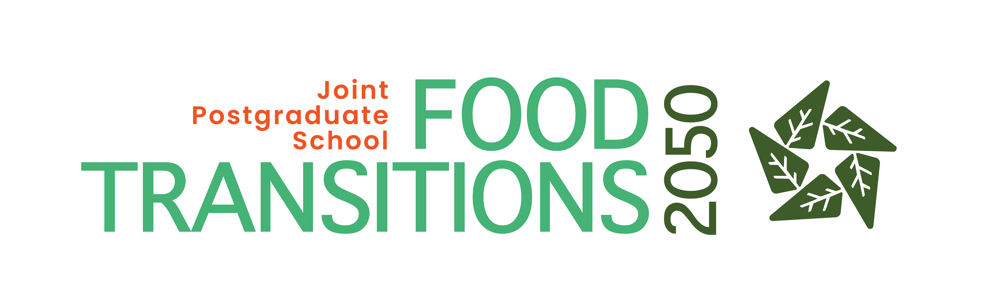

.. lsapy documentation master file, created by
   sphinx-quickstart on Tue Apr 22 19:32:21 2025.
   You can adapt this file completely to your liking, but it should at least
   contain the root `toctree` directive.

:html_theme.sidebar_secondary.remove: true

lsapy Documentation
===================

**Version**: |release| - `What's new? <changelog.html>`__

**Useful links**:
`Code Repository <https://github.com/baptistehamon/lsapy>`__ |
`Issues <https://github.com/baptistehamon/lsapy/issues>`__ |
`Releases <https://github.com/baptistehamon/lsapy/releases>`__ |
`Example Gallery <examples/index.html>`__

*lsapy* is a highly customizable, open-source Python library designed to streamline and enhance Land Suitability Analysis (LSA) workflows.
Its objective is to make conducting LSA in Python easier and more accessible to users. The package implements a fuzzy-logic approach and
provides a set of objects that work together to deliver a flexible and user-defined LSA framework.

.. grid:: 1 1 2 2
   :gutter: 2

   .. grid-item-card:: Get Started!
        :img-top: _static/fast-forward.svg
        :class-card: intro-card
        :link: getting-started/index
        :link-type: doc

        *New to lsapy?*
        Learn how to install and get started with lsapy in a few simple steps.

   .. grid-item-card:: User Guide
        :img-top: _static/book-half.svg
        :class-card: intro-card
        :link: user-guide/index
        :link-type: doc

        *Want to learn more?*
        Explore the lsapy user guides to understand its features and functionalities.

   .. grid-item-card:: API Reference
        :img-top: _static/braces-asterisk.svg
        :class-card: intro-card
        :link: api
        :link-type: doc

        *Need technical details?*
        Access the lsapy API reference for comprehensive information on its classes and methods.

   .. grid-item-card:: Contribute
        :img-top: _static/terminal.svg
        :class-card: intro-card
        :link: community/index
        :link-type: doc

        *Have ideas or improvements? Found a bug?*
        Read our contribution guidelines and get involved in lsapy development.

Supported by
------------

The development of *lsapy* started as part of a PhD, funded by the `Food Transition 2050`_  Joint Postgraduate School and hosted
by the `University of Canterbury`_ in New Zealand.

|FT2050| |UC-white| |UC-black|

.. _`Food Transition 2050`: https://www.foodtransitions2050.ac.nz/
.. _`University of Canterbury`: https://www.canterbury.ac.nz/

.. toctree::
   :maxdepth: 2
   :hidden:

   Get Started <getting-started/index>
   User Guide <user-guide/index>
   Examples Gallery <examples/index>
   API Reference <api>
   Community <community/index>
   Changelog <changelog>
   Bibliography <references>
